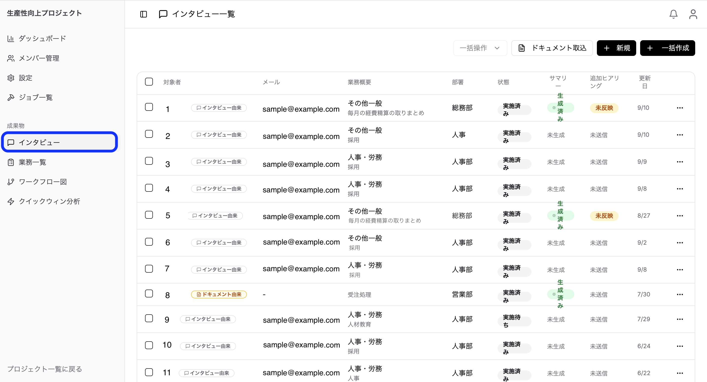
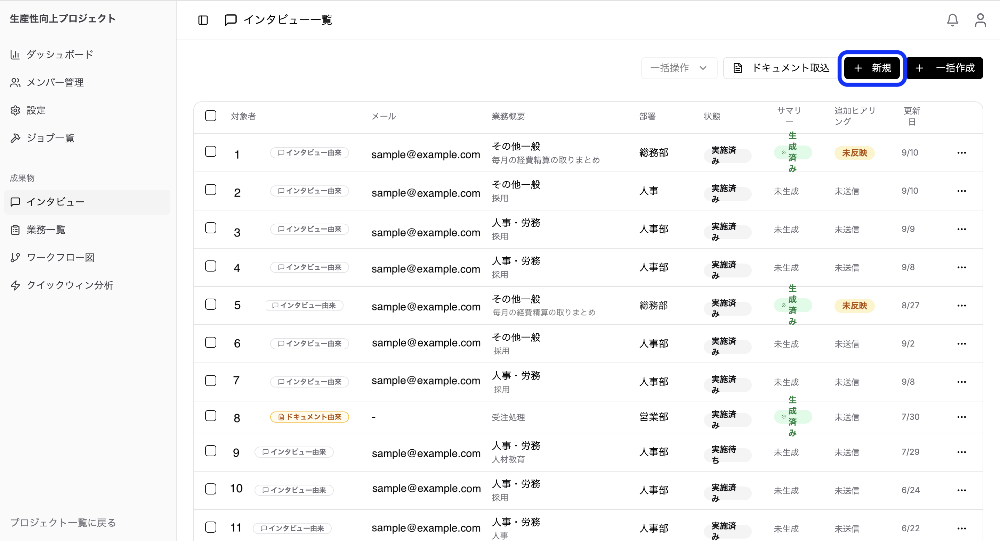
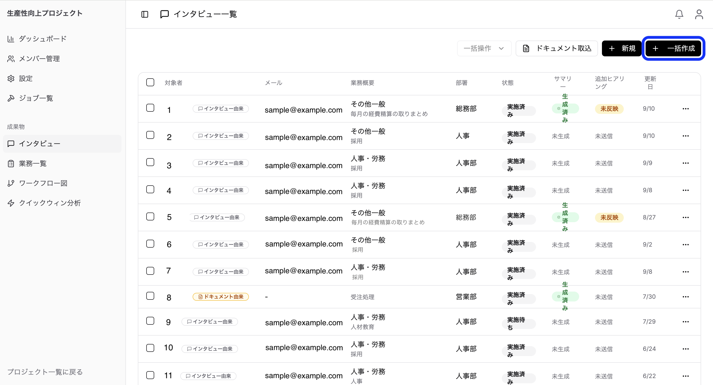
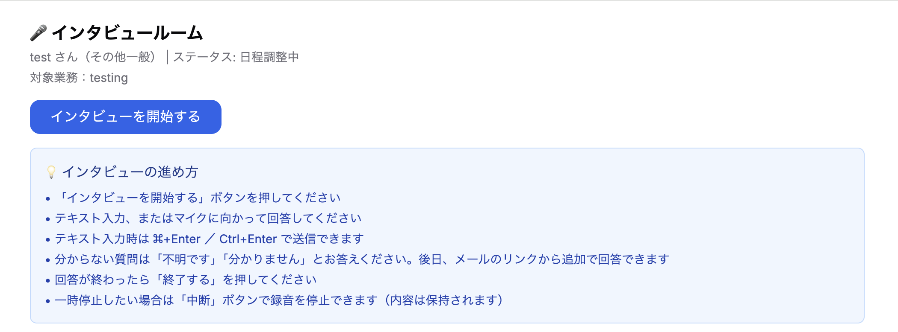
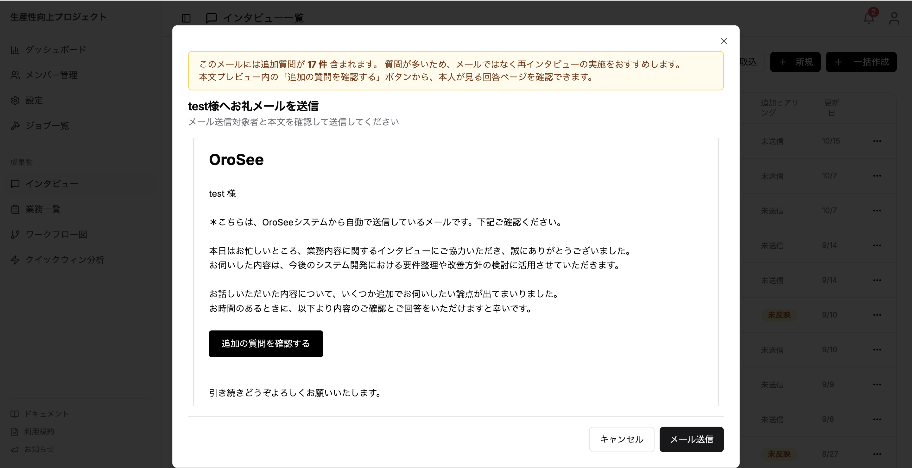
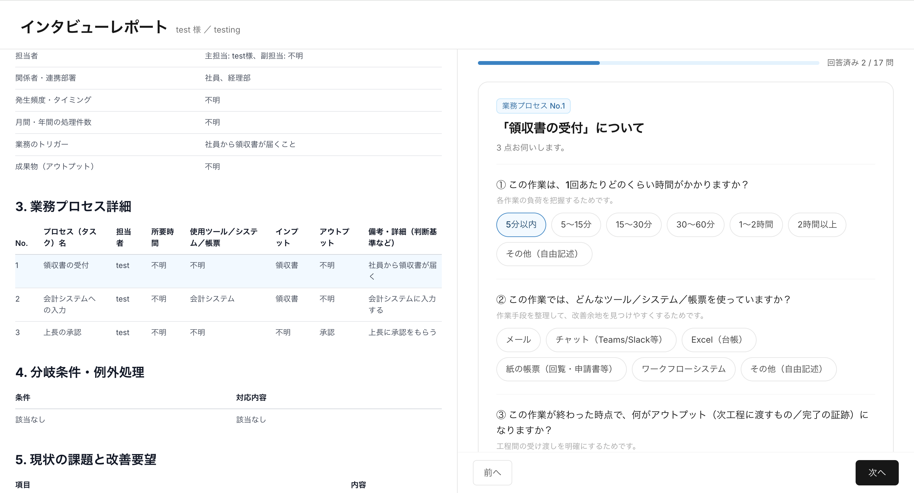
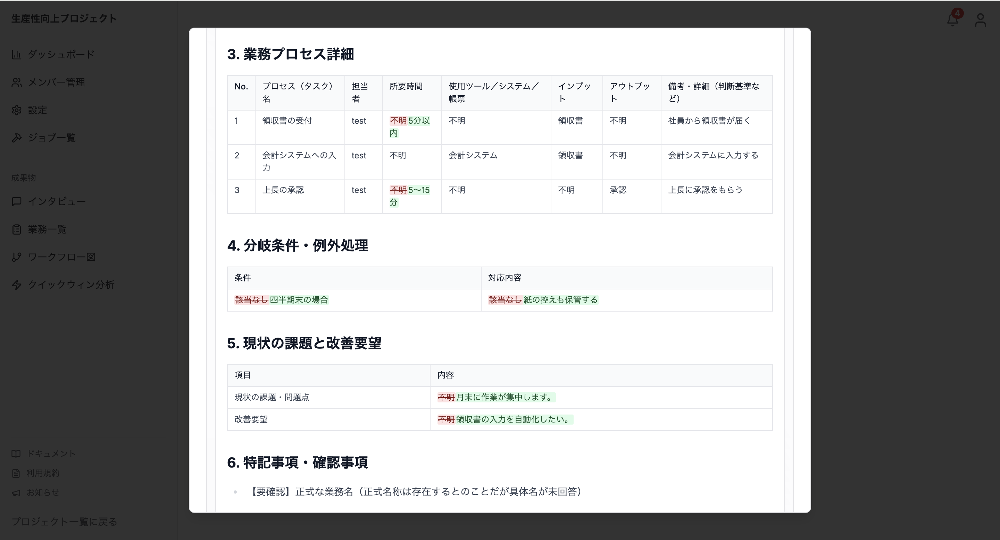

> **運用フローの起点です。** 毎回の運用はこのページから始まります。対象のプロジェクトを選択した状態で操作してください。ここで集めた結果から、次の [③-2 業務を整理する](/guides/business-management/) で使う業務情報を生成します。

### インタビュー一覧画面

サイドバーから「インタビュー」メニューを選択すると、インタビュー一覧画面が表示されます。

**表示項目：**
- 対象者
- メール
- 業務概要
- 部署
- 状態（インタビューが実施されたかどうか）
- サマリー
- 追加ヒアリング（追加の質問への回答状況）
- 更新日

### インタビューの作成（単体/一括）

**単体作成：**

1. 「新規」ボタンをクリック

2. 以下の情報を入力：
   - **氏名**（必須）
   - **メールアドレス**（必須）
   - **業務知識**（必須）：関連するドメイン知識を選択
   - **部署**（必須）
   - **業務概要**（必須）
3. 「作成」をクリック

**一括作成：**

1. 「一括作成」ボタンをクリック

2. 以下のいずれかの方法でデータを入力：
   - **コピー＆ペースト**: ExcelやCSVからセルをコピーして貼り付け
   - **手動入力**: テーブル形式で直接入力
3. データを確認し「一括作成」をクリック

### インタビューステータスの管理

インタビューには以下のステータスがあります：

| ステータス | 説明 |
|-----------|------|
| **日程調整中** | インタビュー日程を調整中 |
| **連絡済み** | 招待メールを送信済み |
| **実施待ち** | インタビュー日程が確定 |
| **実施中** | インタビュー実施中 |
| **実施済み** | インタビュー完了 |

ステータスは以下の方法で更新されます：
- 招待メール送信時：自動的に「連絡済み」に更新
- 手動更新：インタビュー詳細画面から変更

### 招待メールの送信

**個別送信：**

1. インタビュー一覧で対象者を選択
2. 「メール送信」アイコンをクリック
3. メール本文を確認・編集
4. 「送信」をクリック

**一括送信：**

1. インタビュー一覧で複数の対象者を選択
2. 「一括メール送信」ボタンをクリック
3. メール本文を確認・編集
4. 「送信」をクリック

送信されるメールには、***インタビュー対象者専用のアクセスリンクが含まれます。このリンクからAIインタビューに参加できます。***

### 追加ヒアリング

インタビュー中に回答できなかった項目について、インタビュー後にお礼メールで対象者へ追加の質問を送り、回答を集めることができます。回答はサマリーに反映され、より正確な業務情報の生成につながります。

**インタビュー中の案内：**

インタビュー画面の「インタビューの進め方」には、分からない質問は「不明です」「分かりません」と答えれば、後日メールのリンクから追加で回答できることが表示されます。

**お礼メールの送信：**

1. インタビュー一覧で、実施済みのインタビューの行にある「…」メニューを開く
2. 「お礼メール送信」をクリック

3. メール本文を確認（追加の質問がある場合は、件数が表示されます）
4. 「メール送信」をクリック

送信時に、インタビューメモの未記入の項目（空欄・「不明」の項目など）やサマリーの【要確認】の項目から追加の質問が自動で作成され、メールに「追加の質問を確認する」ボタンが付きます。未記入の項目がない場合も、補足を記入できるようリンクは付きます。

> **⚠️ 注意：** 追加の質問へのリンクは、個別に送信したお礼メールにのみ付きます。複数の対象者を選択し、「一括操作」から「お礼メールを送信（〇件）」で一括送信した場合は付きません。

> **💡 ヒント：** 本文プレビューの「追加の質問を確認する」ボタンから、対象者に表示される回答ページを確認できます。質問が5件を超える場合は、メールではなく再インタビューの実施をおすすめするメッセージが表示されます。

**対象者の回答画面：**

対象者がメールのリンクを開くと、左にインタビューのサマリー、右に追加の質問が表示されます。

1. 業務概要や業務プロセスの工程ごとに、選択肢をクリックして回答し「次へ」をクリック

2. インタビュー中に回答を保留した質問は、自由記述で回答
3. 「課題・改善要望」で、業務の課題や改善要望を記入（任意）
4. 「補足・送信」で、言いそびれたことやその後わかったことを記入（任意）
5. 「回答を送信」をクリック

回答状況は「回答済み 〇 / 〇 問」で確認でき、未回答の質問があっても送信できます。

**回答状況の確認：**

インタビュー一覧の「追加ヒアリング」列には、以下のステータスが表示されます：

| ステータス | 説明 |
|-----------|------|
| **未送信** | お礼メールをまだ送信していない |
| **未回答** | お礼メールを送信済みで、回答待ち |
| **未反映** | 回答が届いたが、サマリーにまだ反映していない |
| **反映済み** | 回答をサマリーに反映済み |

**サマリーへの反映：**

1. 「未反映」のインタビューの対象者名をクリックして詳細画面を開く
2. 「追加質問と回答内容」で、対象者の回答や補足（自由記述）を確認
3. 「インタビュー内容 (サマリー)」の「サマリーを生成」をクリック
4. 生成が終わったら「差分」タブで、前のサマリーから変わった箇所を確認

### インタビュー結果からの業務生成（AI機能）

インタビューが完了すると、AIを活用して業務情報を自動生成できます。

**業務自動生成の手順：**

1. 完了したインタビューを選択（複数選択可）
2. 「業務一覧を生成」ボタンをクリック
3. AIがインタビュー内容を分析し、業務情報を抽出
4. 生成された業務が業務一覧に追加される
5. 処理完了は通知で確認

> **💡 ヒント：** 複数のインタビュー結果を組み合わせることで、より包括的な業務情報を生成できます。

> **次の工程へ：** ここで生成された業務は、[③-2 業務を整理する](/guides/business-management/) の業務一覧に追加されます。続いてそちらで内容の確認とスコアリングを行います。