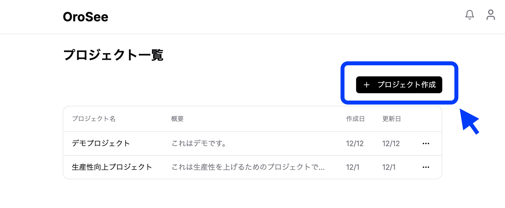
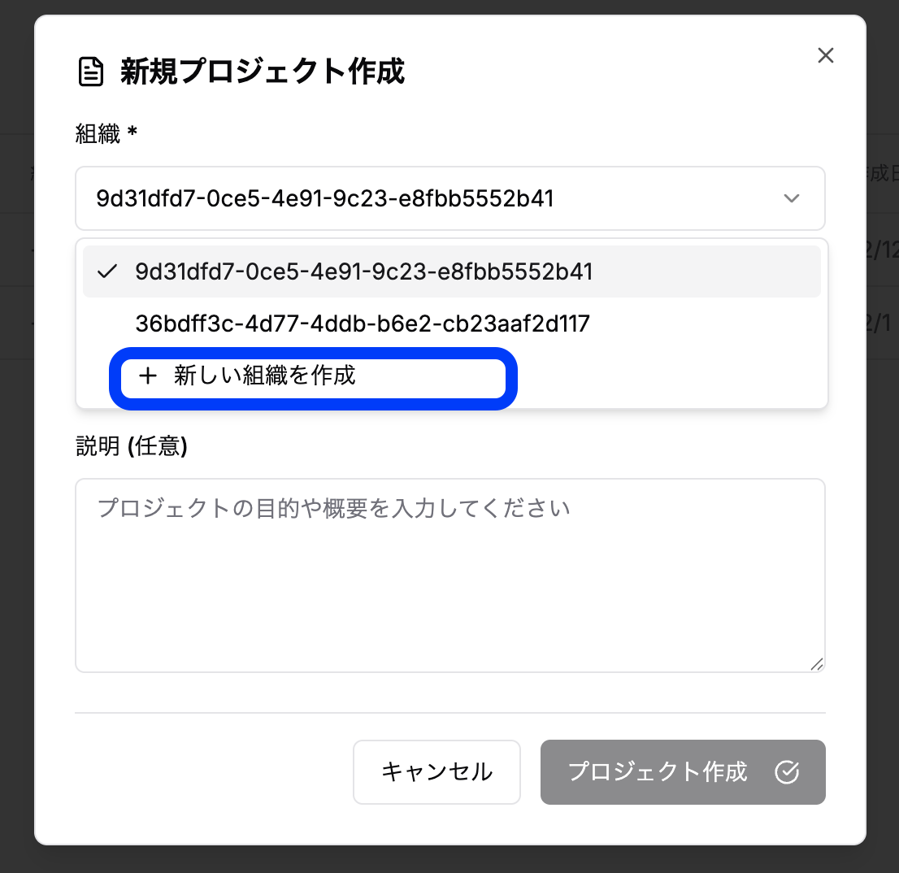
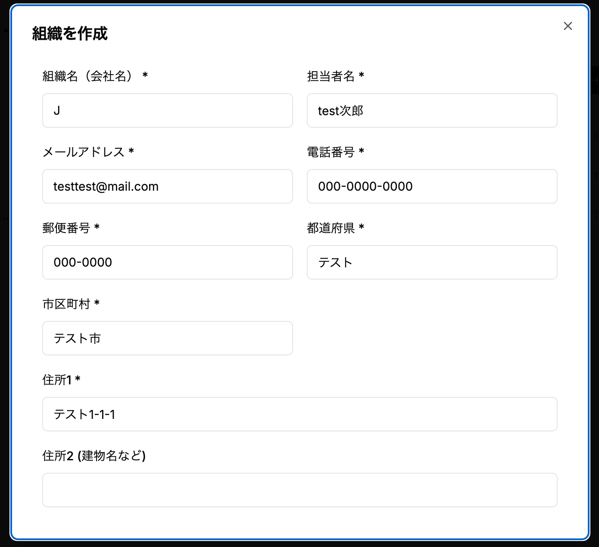
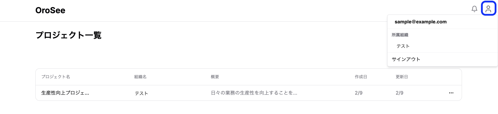
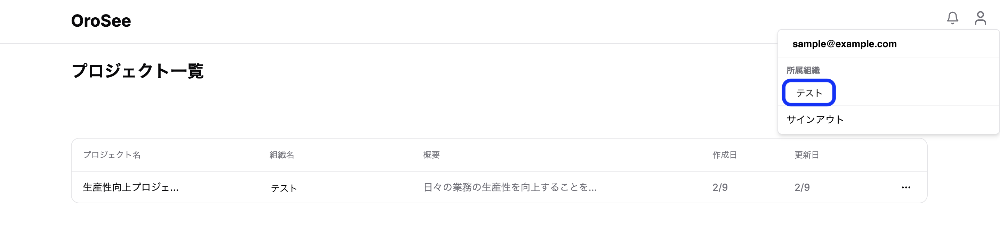
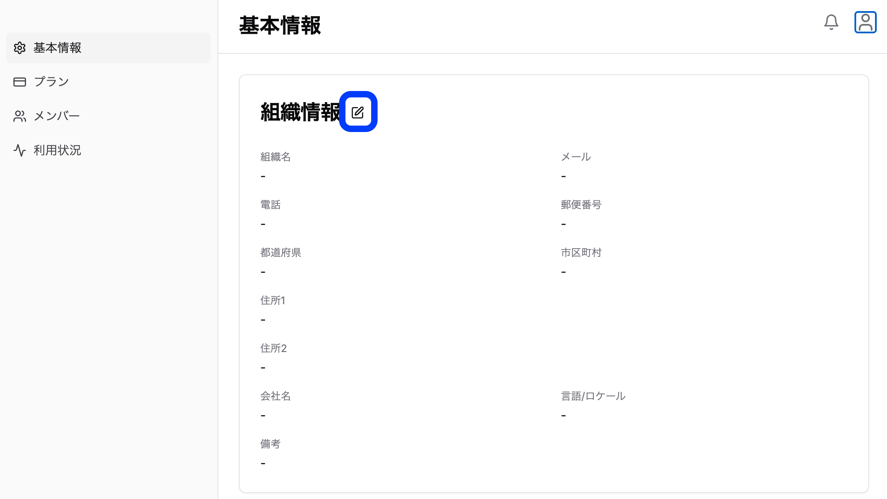

### 組織の作成・編集

**作成**
1. プロジェクト右上にあるプロジェクトの作成をクリック

2. 組織の部分をクリックし、「新しい組織を追加」を選びます

3. 組織の情報を入力します

**編集**
1. 画面右上のユーザーメニューをクリック

2. 組織をクリック

3. 編集ボタンをクリック

4. 保存をクリックします

### 組織メンバーの追加・役割設定

プロジェクトメンバーの管理については、「プロジェクトを作る」の[「プロジェクトメンバーの招待と管理」](/implementation/4-project-management/#プロジェクトメンバーの招待と管理)を参照してください。

### IP制限

組織ごとに、アクセスを許可するIPアドレスを設定できます。IP制限が有効な組織では、許可されたIPアドレス以外からは、OroSeeの画面にアクセスできなくなります。

**IP制限の対象**
- 管理画面（組織・プロジェクトの画面）へのアクセス
- インタビュー画面へのアクセス
- 組織・プロジェクトへの招待の承認

許可されていないIPアドレスからアクセスすると、「このIPアドレスからはアクセスできません」と表示されます（現在のIPアドレスも表示されます）。

> **⚠️ 注意：** インタビューの対象者も、許可されたネットワークからのみインタビューに回答できます。社外や自宅など、許可されていないネットワークから回答する対象者がいる場合はご注意ください。

> **💡 ヒント：** IP制限の設定はOroSee側で行います。ご利用を希望される場合や、許可するIPアドレスを変更したい場合は、[お問い合わせ窓口](/reference/contact-us/)までご連絡ください。
